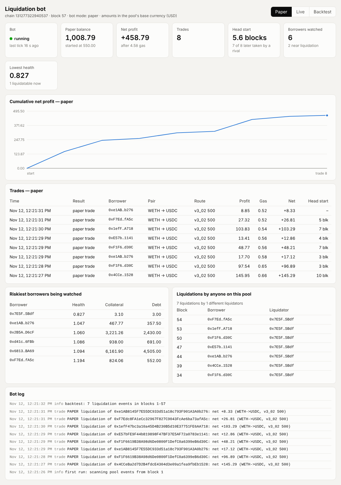

# Liquidation bot

A flash-loan liquidation bot for lending protocols that are forks of Aave v3, plus a
paper-trading mode, a backtester and a web monitor. It lives in this repository only for
convenience; it has nothing to do with ArcSlicer.

**How it earns:** when a borrower's collateral falls below the required level, the protocol
lets anyone repay part of the debt and take the collateral at a discount (usually 5-10%).
The bot borrows the repayment with a flash loan, liquidates, sells the collateral and repays
the loan in a single transaction. Your own money only pays for gas. If the trade would not
be profitable the transaction reverts.



## Status: read this first

- Everything is tested end to end against a **fake market on an in-memory chain** (19 tests).
- It has **not been run against a real chain yet**. Expect to fix small things on first contact
  (RPC limits, a fork that renamed something).
- The contract is unaudited. Keep no funds on it; the bot wallet should hold gas money only.
- Liquidations are rare and contested. Run paper mode for a few weeks before going live.

## Try it in two minutes (no RPC, no money)

```bash
python3 -m venv .venv && .venv/bin/pip install -r requirements-dev.txt
.venv/bin/python -m pytest                 # 19 tests
.venv/bin/python scripts/demo.py           # simulated price crash: paper trading + backtest
.venv/bin/python -m liqbot -c demo.toml monitor     # then open http://127.0.0.1:8787
```

## Pick a target

The edge is not the code, it is the choice of market. Look for an Aave v3 fork that is:

1. **Small and new**: roughly 1-50M USD deposited (DefiLlama lists forks), on a chain with
   cheap gas. Big bots ignore markets where a liquidation pays 20 USD.
2. **Slowly liquidated**: this is what the backtest measures. A long "head start" (positions
   sitting liquidatable for several blocks) and few distinct liquidators mean room for you.
3. **Swappable**: the collateral must be sellable for the debt asset on a DEX on that chain.

You need the protocol's `PoolAddressesProvider` address (in its docs), the chain's wrapped
native token, and a DEX router. Copy `config.example.toml` to `config.toml` and fill them in.

## Backtest with paper money

```bash
.venv/bin/python -m liqbot backtest --from-block 1234567
```

Replays every liquidation that really happened and simulates what this bot would have earned
one block before the real liquidator acted. Needs an **archive** RPC that supports `eth_call`
state overrides (most paid providers; many public endpoints do not keep history).

The result is an **upper bound**: it assumes you win every race you had time to win.
Liquidations done in the same block the price moved are listed as `same-block race` and
never counted, because winning those takes speed this bot does not have.

## Paper trading

```bash
.venv/bin/python -m liqbot run        # with mode = "paper" in config.toml
```

Watches the live chain and simulates each liquidation it would have sent, without sending
anything. No contract deployment, no private key, no funds. When a real liquidator later takes
the same position, the bot records how many blocks of head start you would have had: the
honest measure of whether you would have won.

## Monitor (over Tailscale)

```bash
.venv/bin/python -m liqbot monitor            # serves http://127.0.0.1:8787
tailscale serve --bg 8787                     # reachable at https://<machine>.<tailnet>.ts.net
```

The monitor is read-only and only reads the bot's database file. `tailscale serve` keeps it
inside your tailnet. Do **not** use `tailscale funnel`, which would make it public.

## Going live

1. Create a **new wallet** used for nothing else and fund it with a little gas money.
2. `export LIQBOT_PRIVATE_KEY=0x...` (never put the key in a file in this repo).
3. `.venv/bin/python -m liqbot deploy`, then put the printed address in `config.toml` as
   `liquidator`, and set `mode = "live"`.
4. `.venv/bin/python -m liqbot run`

## Risks and limits

- **Failed transactions cost gas.** If a rival lands first, yours reverts. The bot simulates
  first and the contract enforces a minimum profit, but races are lost on-chain.
- **Speed.** It polls every couple of seconds over public RPC. Good enough for sleepy markets,
  hopeless against professional bots on busy ones.
- **Rollup data fees** (the L1 part of gas on Optimism-style chains) are not in the gas
  estimate; `gas_safety` is the cushion.
- **Borrower discovery** comes from `Borrow` events since `start_block`. Borrowers who are not
  near liquidation are re-checked every `full_rescan_every` ticks, so a sudden crash can be
  noticed up to that long after it happens.
- Profits are taxable income; keep the database as your record.

## Layout

| Path | What |
|---|---|
| `contracts/FlashLiquidator.sol` | the on-chain part: flash loan, liquidate, swap, profit check |
| `liqbot/engine.py` | the loop: discover, watch health, evaluate, act |
| `liqbot/planner.py` | pure logic choosing what to liquidate and how much |
| `liqbot/chain.py` | every RPC call |
| `liqbot/backtest.py`, `liqbot/monitor.py` | backtester and dashboard |
| `liqbot/sim.py`, `contracts/Mocks.sol` | the fake market used by tests and the demo |

After changing a contract: `npm install && npm run compile` (rewrites `liqbot/artifacts/`).
